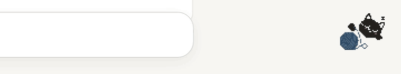

# Cat side chat

Git for your AI chats. A pixel cat sits on your chat. Click it, and it swats its yarn ball, which rolls out into a small chat bar. Ask side questions about any line without touching the main chat, see every side chat as a branch, and start fresh chats that keep everything the old one knew.

Works on **Claude, ChatGPT, Gemini and Grok**. On any other site, click the extension's icon to wake the cat there.

## Install

Works in Chrome, Edge, Brave, Opera and Arc.

1. On this page, click **Code**, then **Download ZIP**, and unzip it somewhere you'll keep it.
2. Open `chrome://extensions` (in Opera: `opera://extensions`) and turn on **Developer mode**.
3. Click **Load unpacked** and pick the unzipped folder.
4. Open claude.ai, chatgpt.com, gemini.google.com or grok.com. The cat appears in the bottom right corner.

To update, replace the folder with the new download, press the reload arrow on the extension's card in `chrome://extensions`, then reload your chat tab.

## Using it

- **Click the cat** to open the bar, and click it again to close it (X and Escape close it too).
- **Highlight** something in the chat first, and the side question is about that part.
- **Type a question** and press Enter. Tab+Enter or Shift+Enter makes a new line.
- **Type /** or press the / button to see the commands. Arrow keys move, Enter or Tab picks.
- **Move the cat:** double-tap it and it follows your pointer until you tap again to drop it. Escape puts it back. You can also press and hold it for a moment, then drag. It remembers where you left it.
- **Size:** the cat sizes itself to your monitor and stays sharp at any display scaling.

## Commands

| Command | What it does |
|---|---|
| `/branch` | Ask a side question about this chat. Just typing a question does the same. |
| Branch from here | The button under each side answer. Starts a new branch of that side chat from that point, as deep as you like, without changing the original. |
| `/merge` | Writes a short note of what you worked out in the side chat and puts it in the main chat's message box. You read it and press send yourself. |
| `/tree` | A map of everything that grew out of this chat: the main chat's messages, each side chat hanging off the message it came from, merged ones marked, and the chats forked from it. Click anything to jump to it. |
| `/fork` | Starts a fresh chat that already knows everything from this one, using a memory pack. |
| `/share` | Makes a memory pack of this chat (project, decisions, key details, next steps) for a teammate. You can edit it first, and lines that look like passwords or keys are flagged. |
| `/clone` | Paste a teammate's pack to start a chat that's already caught up. Packs work across AIs: share from ChatGPT, clone into Claude. |
| `/key` | Saves your free Gemini key (see below). |

## Who answers the cat's questions

- **On Claude:** your own Claude account answers, in a hidden chat that's deleted when you close the side chat. Nothing extra to pay.
- **Everywhere else:** Google's Gemini answers, using a free API key. Get one at [aistudio.google.com/apikey](https://aistudio.google.com/apikey) and paste it in when the cat asks (or with `/key`). The key stays in your browser. The free tier has limits, so if it says the limit is used up, wait a minute.

On sites other than Claude, `/fork` and `/clone` open a new chat with the pack already in the message box. Press send to start.

## The cat's faces

It's happy when the bar opens and thinking while an answer comes in. It gets star eyes when you merge, winks when you copy a pack, looks surprised on errors, and gets sleepy if nobody moves for a while. It also blinks, breathes, follows your pointer, and bats its ball now and then.

## Good to know

- The cat reads chats from each site's page, and on Claude from the same data the page loads. None of this is an official API, so a site redesign can break it. Each site's reading code is a few lines in `sites.js`, so fixes are quick. If something breaks, open an issue.
- Automating these sites may go against their terms, so use it for your own chats.
- Side questions on Claude count toward your normal usage limits.

## Files

| File | What it does |
|---|---|
| `manifest.json` | Tells the browser what the extension is and where it runs |
| `background.js` | Talks to Gemini for the free key route, and wakes the cat when you click the icon |
| `sites.js` | The only part that knows each site: reads the chat, finds the message box |
| `claude.js` | Claude account access: reads the chat and asks in hidden chats |
| `ai.js` | Picks who answers (your Claude account or a Gemini key) |
| `brain.js` | What each command does, step by step |
| `store.js` | Saves side chats, links between chats, and settings |
| `shell.js` | Everything you see: the cat, bar, menu and panels |
| `cat-roll.js` | Draws the pixel cat, its faces and the yarn roll |
| `logo-data.js` | The cat's shape, traced from the logo |
| `theme.js` | Matches the site's light or dark colors |
| `markdown.js` | Shows answers with code blocks and lists |

## Feedback

This is the first version. Tell me what you want the cat to do next: open an issue here or reply on X.
